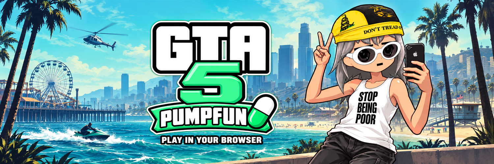
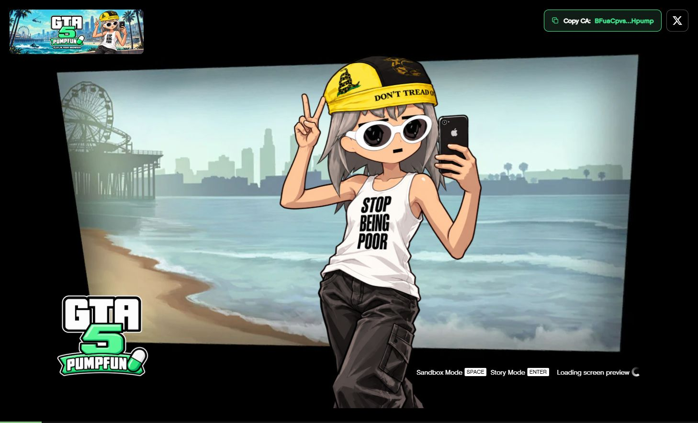
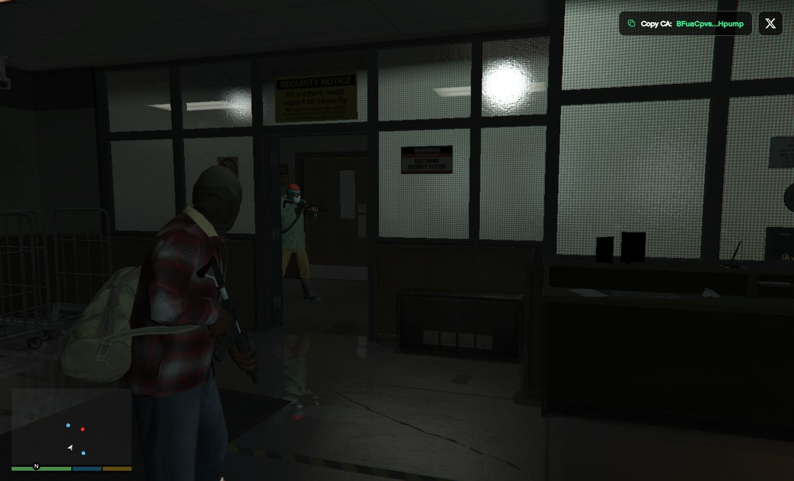

<p align="center">
  
</p>

<h1 align="center">GTA 5 Browser</h1>

<p align="center">Los Santos. In your browser. Live on Pump.fun.</p>

<p align="center">
  <a href="https://gta5browser.fun/">Play Now</a> ·
  <a href="https://x.com/gta5browser">Follow on X</a> ·
  <a href="#support-the-project">Support the Project</a>
</p>



GTA 5 Browser brings the GTA 5 experience to a WebGPU browser with our custom loading screen, project logo, and desktop and mobile controls. This repository contains the GTA5 Browser website, browser runtime, loading artwork, data manifests, and local launcher.

## Official project links

| | Address |
| --- | --- |
| Website | [gta5browser.fun](https://gta5browser.fun/) |
| X | [@gta5browser](https://x.com/gta5browser) |
| Repository | [playgta5browser/GTA5-Browser](https://github.com/playgta5browser/GTA5-Browser) |
| Pump.fun CA — Solana | `BFuaCpvsSUnRe3rmnNGFNnabudDgHVR28EC2bCKHpump` |

The contract address above is the project's official Pump.fun CA. The donation wallet below is a separate address.

## Support the project

Donations help support GTA5 Browser development and hosting.

**Donation wallet · Solana**

```text
HJVUx4rq1XnLijYLY6ARUddM1n5yyMU5ZYYjMhK26xqV
```

## Run locally

Use Python 3.11 or newer and a current browser with WebGPU enabled. A stable internet connection is needed for streamed game data.

1. Download this repository using **Code → Download ZIP**, then extract it. Or clone it:

   ```bash
   git clone https://github.com/playgta5browser/GTA5-Browser.git
   cd GTA5-Browser
   ```

2. On Windows, double-click **Start GTA.cmd**. The launcher creates a local Python environment, installs the server dependencies, and opens the game at **http://127.0.0.1:8766/**. Keep the terminal open while playing.

   On macOS or Linux:

   ```bash
   python3 -m venv .venv
   .venv/bin/python -m pip install -r requirements.txt
   .venv/bin/python server.py --open
   ```

3. Click inside the game to focus the controls. Press **Esc** to release the mouse.

For an occupied port, run `python server.py --port 8770 --open` using the installed environment. To preview the loading screen without starting the engine, open **http://127.0.0.1:8766/?preview=1**.

The launcher serves the isolation headers required for WebGPU and shared memory. Open the HTTP address above; opening `index.html` directly will not start the engine.

## Controls

| Desktop | Action |
| --- | --- |
| W / A / S / D | Move |
| Mouse | Look around |
| Left mouse button | Fire |
| Right mouse button | Aim |
| Shift | Run |
| Space | Jump / handbrake |
| F | Enter / exit vehicle |
| R | Reload |
| Esc | Pause / release mouse |

Touch devices get a movement joystick, swipe camera, action buttons, pause navigation, and fullscreen controls where supported. Landscape orientation is recommended. The device must support WebGPU, shared memory, and the runtime's memory requirements.

## Screenshots

### Project loading screen



### Gameplay



## Project files

| Path | Contents |
| --- | --- |
| `index.html` | Game entry point, custom loading screen, CA button, and X link |
| `assets/` | GTA5 Browser logo, banner, icons, and touch controls |
| `b/` | Browser engine, workers, shaders, and loading artwork |
| `data/` | Game file manifests and startup lists |
| `server.py` | Local HTTP server with isolation headers and data relay |
| `Start GTA.cmd` | Windows setup and launcher |
| `source-refresh.json` | Runtime build configuration and checksums |

Game archives are streamed from the configured data host and cached by the browser. The full archive set, approximately 19.5 GiB, is separate from this repository. Uncached data requires the data host to remain available. Savegames are stored per browser origin; the local version and live website use separate saves.

## Validation

The existing controls and loader checks can be run with Node.js:

```bash
node verify-controls.mjs
node verify-mobile-controls.mjs
node verify-loader-startup.mjs
```

Project branding and repository presentation are maintained by **playgta5browser**. Third-party runtime components and game materials retain their respective ownership and license notices. GTA5 Browser is a community project and is not affiliated with Rockstar Games or Take-Two Interactive.
